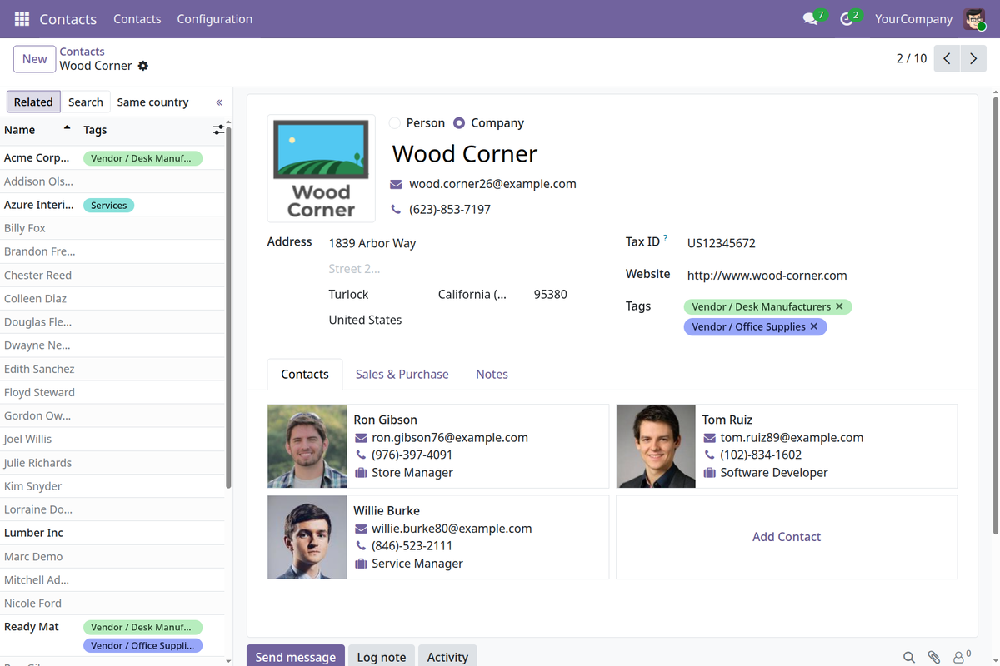
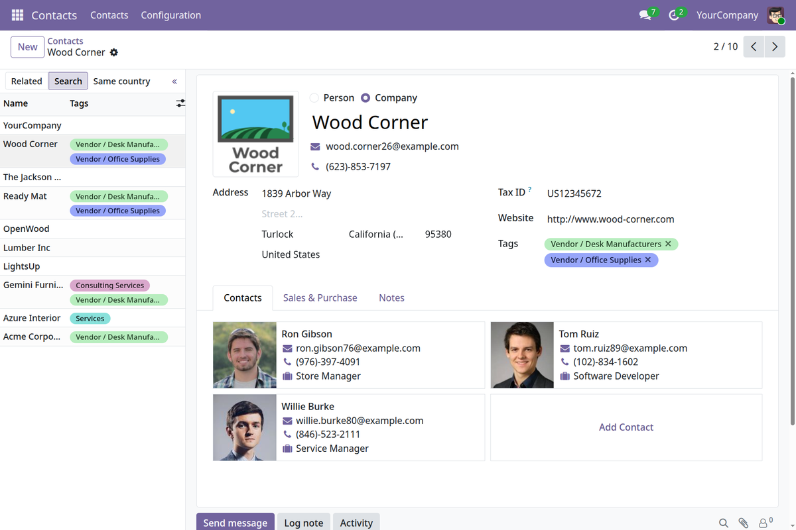
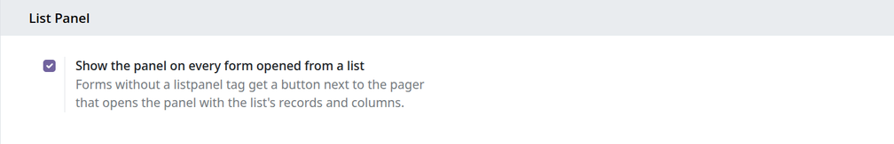
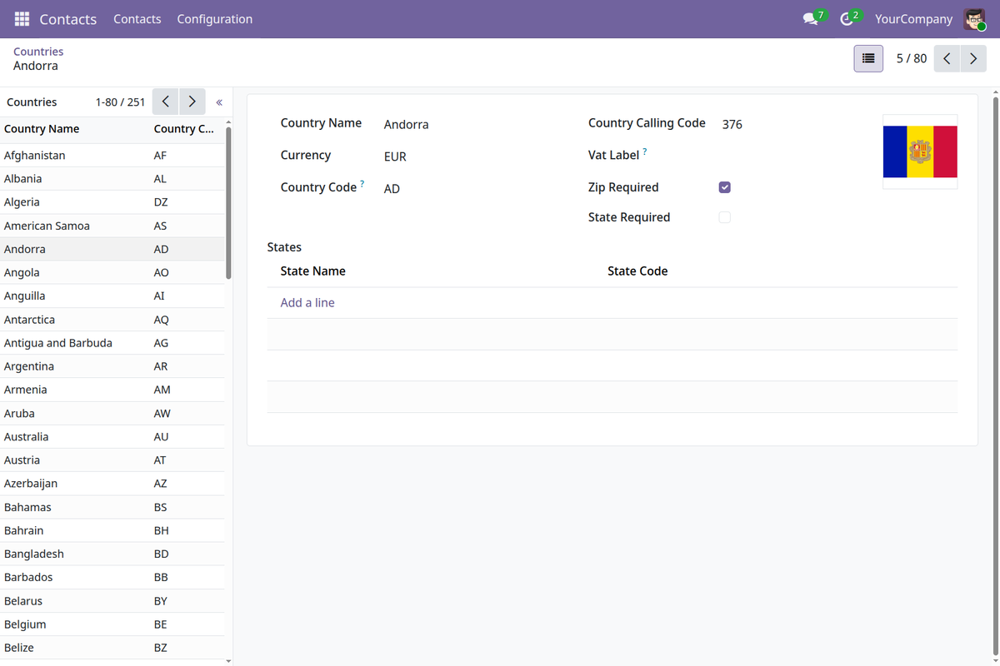

.. image:: https://odoo-community.org/readme-banner-image
   :target: https://odoo-community.org/get-involved?utm_source=readme
   :alt: Odoo Community Association

===================
Web Form List Panel
===================

.. 
   !!!!!!!!!!!!!!!!!!!!!!!!!!!!!!!!!!!!!!!!!!!!!!!!!!!!
   !! This file is generated by oca-gen-addon-readme !!
   !! changes will be overwritten.                   !!
   !!!!!!!!!!!!!!!!!!!!!!!!!!!!!!!!!!!!!!!!!!!!!!!!!!!!
   !! source digest: sha256:f49c78110de9ce8f9240525bb8d156054dfb1f7bb36a2ae6bc5aab247fe9efed
   !!!!!!!!!!!!!!!!!!!!!!!!!!!!!!!!!!!!!!!!!!!!!!!!!!!!

.. |badge1| image:: https://img.shields.io/badge/maturity-Beta-yellow.png
    :target: https://odoo-community.org/page/development-status
    :alt: Beta
.. |badge2| image:: https://img.shields.io/badge/license-LGPL--3-blue.png
    :target: http://www.gnu.org/licenses/lgpl-3.0-standalone.html
    :alt: License: LGPL-3
.. |badge3| image:: https://img.shields.io/badge/github-OCA%2Fweb-lightgray.png?logo=github
    :target: https://github.com/OCA/web/tree/19.0/web_form_listpanel
    :alt: OCA/web
.. |badge4| image:: https://img.shields.io/badge/weblate-Translate%20me-F47D42.png
    :target: https://translation.odoo-community.org/projects/web-19-0/web-19-0-web_form_listpanel
    :alt: Translate me on Weblate
.. |badge5| image:: https://img.shields.io/badge/runboat-Try%20me-875A7B.png
    :target: https://runboat.odoo-community.org/builds?repo=OCA/web&target_branch=19.0
    :alt: Try me on Runboat

|badge1| |badge2| |badge3| |badge4| |badge5|

This module adds a ``<listpanel>`` element for form views. It shows a
compact, read-only list on the left of the form, and clicking a row
opens that record in the form. It is meant for form-oriented work, where
the record you are editing has correlated records and you want to keep
them in view.

The panel has two modes, switched from its header:

- **Related**: the records matching a domain evaluated on the current
  record, for example the other orders of the same customer. The domain
  can also be computed on the server.
- **Search**: the records of the list or kanban view the form was opened
  from, with the same filters, sort order and page.

Its columns are drawn by Odoo's list renderer, so widgets, decorations,
optional columns and totals work as in a list view. The panel pages like
a list view, can be collapsed, and is hidden in dialogs and on small
screens.

With the **Auto panel** setting, forms that declare no ``<listpanel>``
can show the panel too, with the records and columns of the list they
were opened from.

**Table of contents**

.. contents::
   :local:

Usage
=====

Add a ``<listpanel>`` element to a form view, as its last child. The
panel is shown on the left of the form wherever it is declared:

.. code:: xml

   <form>
       <sheet>...</sheet>
       <listpanel domain="[('partner_id', '=', partner_id)]"
                  order="date_order desc"
                  limit="80"
                  string="Orders of this customer"
                  invisible="not partner_id"
                  decoration-muted="state == 'cancel'">
           <field name="name"/>
           <field name="state" widget="badge"/>
           <field name="tag_ids" widget="many2many_tags" optional="hide"/>
           <field name="amount_total" sum="Total"/>
       </listpanel>
   </form>

+----------------------+-----------------------+-----------------------+
| Attribute            | Meaning               | Default               |
+======================+=======================+=======================+
| ``domain``           | Related mode domain,  | none: only Search     |
|                      | evaluated on the      | mode                  |
|                      | current record. It    |                       |
|                      | may be a list or a    |                       |
|                      | field holding a       |                       |
|                      | domain.               |                       |
+----------------------+-----------------------+-----------------------+
| ``order``            | Order in Related      | the model's order     |
|                      | mode, and in Search   |                       |
|                      | mode when the origin  |                       |
|                      | view has no sort      |                       |
+----------------------+-----------------------+-----------------------+
| ``limit``            | Rows per page         | 80                    |
+----------------------+-----------------------+-----------------------+
| ``string``           | Title in the panel    | none                  |
|                      | header                |                       |
+----------------------+-----------------------+-----------------------+
| ``invisible``        | Hide the panel for    | visible               |
|                      | some records          |                       |
+----------------------+-----------------------+-----------------------+
| ``decoration-*``     | Row decorations, as   | none                  |
|                      | on ``<list>``         |                       |
+----------------------+-----------------------+-----------------------+
| ``<field>`` children | Columns, with the     | the record name       |
|                      | attributes of a list  |                       |
|                      | column                |                       |
+----------------------+-----------------------+-----------------------+

The panel is drawn by Odoo's own list renderer, so the ``<field>``
children take what a ``<list>`` column takes: ``widget``, ``options``,
``decoration-*``, ``optional``, ``column_invisible``, ``sum``/``avg``,
``width``, ``string``, and so on. ``column_invisible`` is evaluated on
the record open in the form. Clicking a column header sorts the panel;
switching mode goes back to the mode's order. Buttons, grouping and row
handles are not supported. Columns may shrink below a list's usual
widths to fit the panel; a column with a ``width`` keeps it. As in a
list, the panel loads by itself the fields its expressions name and the
currency of a monetary column, so they need no column of their own.

**Inheriting views.** The panel's columns are ``<field>`` nodes of the
form arch. An inheriting view that locates a field with
``<field name="x" position="...">`` or ``//field[@name='x']`` gets the
first one in the arch: keep the ``<listpanel>`` after the ``<sheet>``,
as above, so that it is the form's own field, or use a more precise path
such as ``//sheet//field[@name='x']``.

Related mode, here the companies of the same country:

|Related mode|

**Server-side domain.** Point ``domain`` at a computed field that
returns the domain, as Odoo does for dynamic many2one domains. A
``Binary`` field may return a list and a ``Char`` field a domain string:

.. code:: python

   listpanel_domain = fields.Binary(compute="_compute_listpanel_domain")

   @api.depends("partner_id")
   def _compute_listpanel_domain(self):
       for rec in self:
           rec.listpanel_domain = [("partner_id", "=", rec.partner_id.id)]

.. code:: xml

   <field name="listpanel_domain" invisible="1"/>
   <listpanel domain="listpanel_domain"/>

The panel reloads whenever the evaluated domain changes, including after
an onchange.

**Search mode** is available when the form was opened from a list or
kanban view. Clicking a row saves the current record if needed, opens
the clicked one, and sets the form's pager to the rows of the panel
page.

Search mode, opened from the Companies list sorted by name, descending:

|Search mode|

**Auto panel.** To get the panel on forms that do not declare it, go to
Settings › General Settings › List Panel and tick "Show the panel on
every form opened from a list", then reload the page. A form opened from
a list or kanban view then has a list button just before its pager. The
button shows or hides the panel, and the choice is remembered for each
model. The panel lists the records of that list, in Search mode, with
the columns that were visible in the list (at most three), drawn with
the list's widgets and row decorations. A kanban view gives the record
name. Like the panel, the button is hidden on small screens. Forms that
declare ``<listpanel>`` keep their own panel and ignore the setting.

|Auto panel setting|

The Countries form, which has no ``<listpanel>``, with the panel opened
from the list button:

|Auto panel|

Bug Tracker
===========

Bugs are tracked on `GitHub Issues <https://github.com/OCA/web/issues>`_.
In case of trouble, please check there if your issue has already been reported.
If you spotted it first, help us to smash it by providing a detailed and welcomed
`feedback <https://github.com/OCA/web/issues/new?body=module:%20web_form_listpanel%0Aversion:%2019.0%0A%0A**Steps%20to%20reproduce**%0A-%20...%0A%0A**Current%20behavior**%0A%0A**Expected%20behavior**>`_.

Do not contact contributors directly about support or help with technical issues.

Credits
=======

Authors
-------

* Roberto Fichera

Contributors
------------

- Roberto Fichera

Maintainers
-----------

This module is maintained by the OCA.

.. image:: https://odoo-community.org/logo.png
   :alt: Odoo Community Association
   :target: https://odoo-community.org

OCA, or the Odoo Community Association, is a nonprofit organization whose
mission is to support the collaborative development of Odoo features and
promote its widespread use.

.. |maintainer-robyf70| image:: https://github.com/robyf70.png?size=40px
    :target: https://github.com/robyf70
    :alt: robyf70

Current `maintainer <https://odoo-community.org/page/maintainer-role>`__:

|maintainer-robyf70| 

This module is part of the `OCA/web <https://github.com/OCA/web/tree/19.0/web_form_listpanel>`_ project on GitHub.

You are welcome to contribute. To learn how please visit https://odoo-community.org/page/Contribute.
