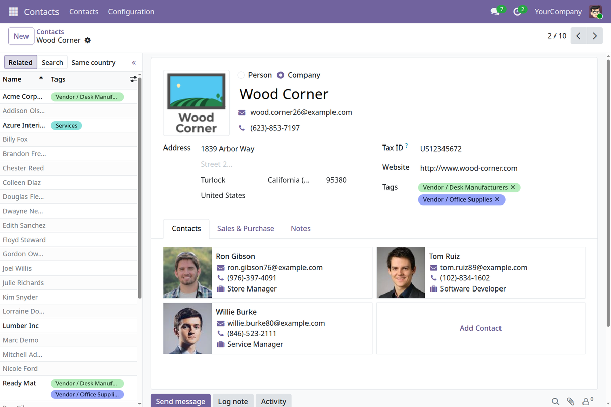
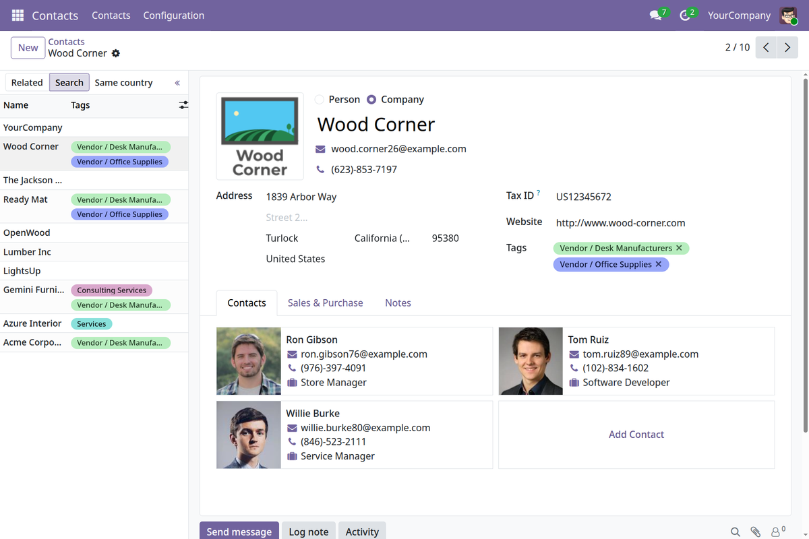
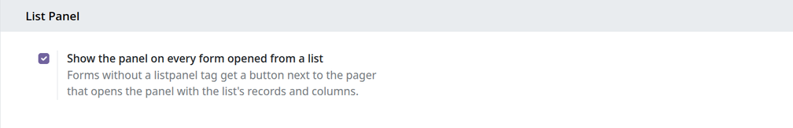
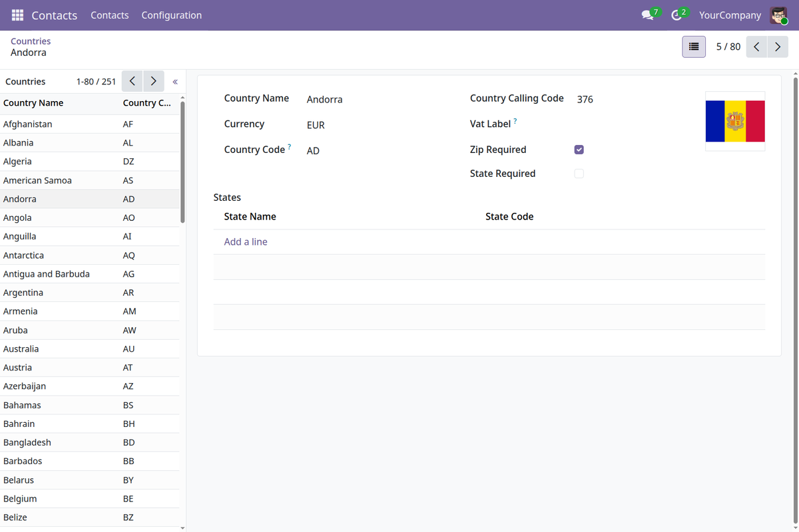

Add a `<listpanel>` element to a form view, as its last child. The panel is
shown on the left of the form wherever it is declared:

``` xml
<form>
    <sheet>...</sheet>
    <listpanel domain="[('partner_id', '=', partner_id)]"
               order="date_order desc"
               limit="80"
               string="Orders of this customer"
               invisible="not partner_id"
               decoration-muted="state == 'cancel'">
        <field name="name"/>
        <field name="state" widget="badge"/>
        <field name="tag_ids" widget="many2many_tags" optional="hide"/>
        <field name="amount_total" sum="Total"/>
    </listpanel>
</form>
```

| Attribute | Meaning | Default |
|----|----|----|
| `domain` | Related mode domain, evaluated on the current record. It may be a list or a field holding a domain. | none: only Search mode |
| `order` | Order in Related mode, and in Search mode when the origin view has no sort | the model's order |
| `limit` | Rows per page | 80 |
| `string` | Title in the panel header | none |
| `invisible` | Hide the panel for some records | visible |
| `decoration-*` | Row decorations, as on `<list>` | none |
| `<field>` children | Columns, with the attributes of a list column | the record name |

The panel is drawn by Odoo's own list renderer, so the `<field>` children
take what a `<list>` column takes: `widget`, `options`, `decoration-*`,
`optional`, `column_invisible`, `sum`/`avg`, `width`, `string`, and so on.
`column_invisible` is evaluated on the record open in the form. Clicking a
column header sorts the panel; switching mode goes back to the mode's order.
Buttons, grouping and row handles are not supported.
Columns may shrink below a list's usual widths to fit the panel; a column
with a `width` keeps it.
As in a list, the panel loads by itself the fields its expressions name and
the currency of a monetary column, so they need no column of their own.

**Inheriting views.** The panel's columns are `<field>` nodes of the form
arch. An inheriting view that locates a field with `<field name="x"
position="...">` or `//field[@name='x']` gets the first one in the arch: keep
the `<listpanel>` after the `<sheet>`, as above, so that it is the form's own
field, or use a more precise path such as `//sheet//field[@name='x']`.

Related mode, here the companies of the same country:



**Server-side domain.** Point `domain` at a computed field that returns the
domain, as Odoo does for dynamic many2one domains. A `Binary` field may return
a list and a `Char` field a domain string:

``` python
listpanel_domain = fields.Binary(compute="_compute_listpanel_domain")

@api.depends("partner_id")
def _compute_listpanel_domain(self):
    for rec in self:
        rec.listpanel_domain = [("partner_id", "=", rec.partner_id.id)]
```

``` xml
<field name="listpanel_domain" invisible="1"/>
<listpanel domain="listpanel_domain"/>
```

The panel reloads whenever the evaluated domain changes, including after an
onchange.

**Search mode** is available when the form was opened from a list or kanban
view. Clicking a row saves the current record if needed, opens the clicked one,
and sets the form's pager to the rows of the panel page.

Search mode, opened from the Companies list sorted by name, descending:



**Auto panel.** To get the panel on forms that do not declare it, go to
Settings › General Settings › List Panel and tick "Show the panel on every
form opened from a list", then reload the page. A form opened from a list or
kanban view then has a list button just before its pager. The button shows or
hides the panel, and the choice is remembered for each model. The panel lists
the records of that list, in Search mode, with the columns that were visible
in the list (at most three), drawn with the list's widgets and row
decorations. A kanban view gives the record name. Like the panel, the
button is hidden on small screens. Forms that
declare `<listpanel>` keep their own panel and ignore the setting.



The Countries form, which has no `<listpanel>`, with the panel opened from the
list button:


