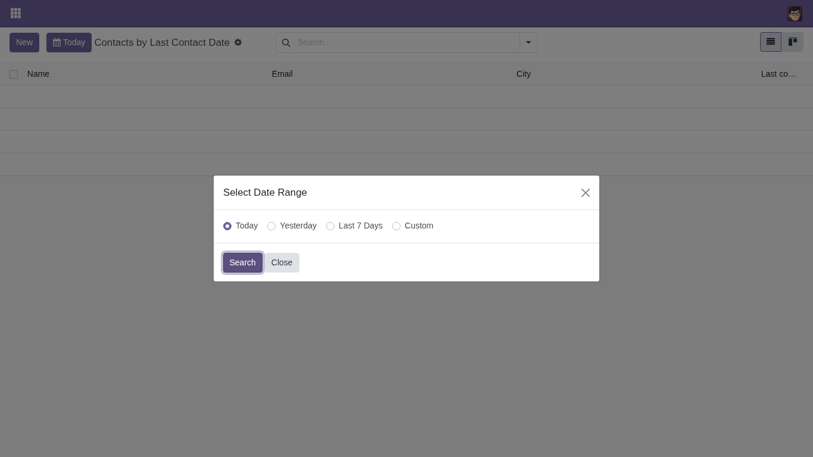
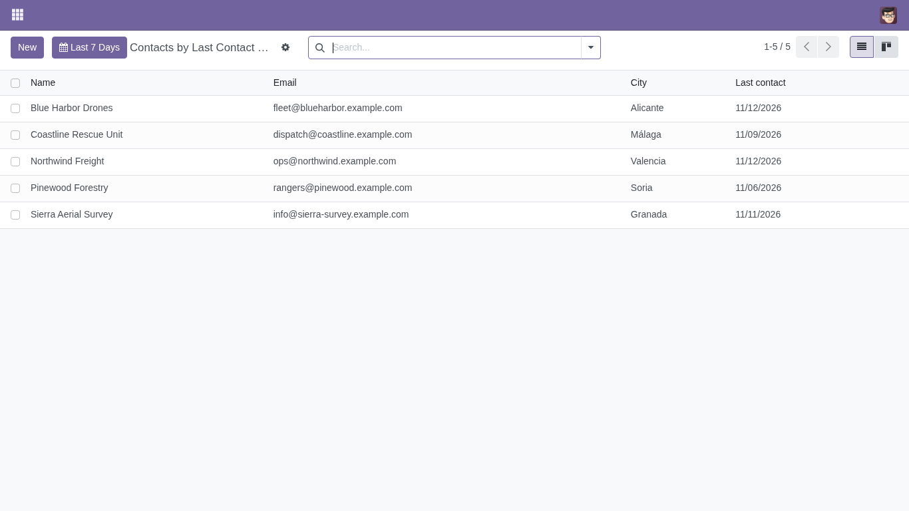
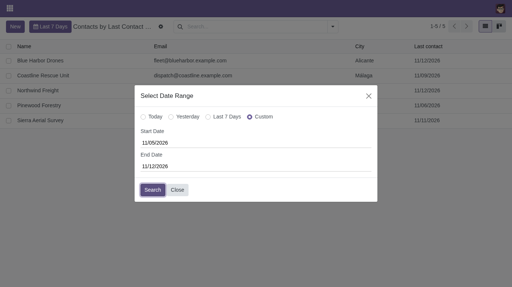

==================================
List View with Required Date Range
==================================

.. 
   !!!!!!!!!!!!!!!!!!!!!!!!!!!!!!!!!!!!!!!!!!!!!!!!!!!!
   !! This file is generated by oca-gen-addon-readme !!
   !! changes will be overwritten.                   !!
   !!!!!!!!!!!!!!!!!!!!!!!!!!!!!!!!!!!!!!!!!!!!!!!!!!!!
   !! source digest: sha256:e561faec9e55d0d3565c83321f7038017632c769e397cb05dd6e16133a436611
   !!!!!!!!!!!!!!!!!!!!!!!!!!!!!!!!!!!!!!!!!!!!!!!!!!!!

.. |badge1| image:: https://img.shields.io/badge/maturity-Beta-yellow.png
    :target: https://odoo-community.org/page/development-status
    :alt: Beta
.. |badge2| image:: https://img.shields.io/badge/licence-AGPL--3-blue.png
    :target: http://www.gnu.org/licenses/agpl-3.0-standalone.html
    :alt: License: AGPL-3
.. |badge3| image:: https://img.shields.io/badge/github-OCA%2Fweb-lightgray.png?logo=github
    :target: https://github.com/OCA/web/tree/17.0/web_list_date_range_required
    :alt: OCA/web
.. |badge4| image:: https://img.shields.io/badge/weblate-Translate%20me-F47D42.png
    :target: https://translation.odoo-community.org/projects/web-17-0/web-17-0-web_list_date_range_required
    :alt: Translate me on Weblate
.. |badge5| image:: https://img.shields.io/badge/runboat-Try%20me-875A7B.png
    :target: https://runboat.odoo-community.org/builds?repo=OCA/web&target_branch=17.0
    :alt: Try me on Runboat

|badge1| |badge2| |badge3| |badge4| |badge5|

This module adds a list view type, ``date_range_list``, that asks for a
date range before showing any record and then filters the list by that
range.

It is meant for models with very large tables (GPS positions, IoT
readings, logs...) where loading every record by default is slow or not
possible at all.

The range can be today, yesterday, the last 7 days or a custom range
with a configurable maximum length. When the user switches to another
view of the same action (form, pivot, map...) or comes back through the
breadcrumbs, the range is kept.

**Table of contents**

.. contents::
   :local:

Usage
=====

Set ``js_class="date_range_list"`` on a list view and mark the date or
datetime field to filter on with a ``date_range`` key in its
``options``:

.. code:: xml

   <tree js_class="date_range_list">
       <field name="name"/>
       <field name="create_date" options="{'date_range': {'max_days': 90}}"/>
   </tree>

- ``date_range``: ``True``, or a dictionary with ``max_days``, the
  longest custom range in days (60 by default).
- The field can be hidden with ``column_invisible="True"`` if it should
  not be a column.

When the list opens, a dialog asks for the range and no record is loaded
until the user confirms it:

|Date range dialog|

The list then shows only the records in that range. The button next to
*New* shows the current range and opens the dialog again to change it:

|List filtered by the last 7 days|

*Custom* lets the user pick any start and end, up to ``max_days``:

|Custom date range|

With demo data, the module adds *Settings > Users & Companies > Contacts
by Last Contact Date*: a contacts list filtered by the *Date* field,
with demo contacts dated from today back to 45 days ago.

Bug Tracker
===========

Bugs are tracked on `GitHub Issues <https://github.com/OCA/web/issues>`_.
In case of trouble, please check there if your issue has already been reported.
If you spotted it first, help us to smash it by providing a detailed and welcomed
`feedback <https://github.com/OCA/web/issues/new?body=module:%20web_list_date_range_required%0Aversion:%2017.0%0A%0A**Steps%20to%20reproduce**%0A-%20...%0A%0A**Current%20behavior**%0A%0A**Expected%20behavior**>`_.

Do not contact contributors directly about support or help with technical issues.

Credits
=======

Authors
-------

* Heligrafics Fotogrametria S.L.

Contributors
------------

- Heligrafics Fotogrametria S.L. <http://www.heligrafics.net/>:

  - Jose Zambudio <jzambudio@heligrafics.net>
  - Mauro Cebriá Berbegal <mcebria@heligrafics.net>

Maintainers
-----------

This module is maintained by the OCA.

.. image:: https://odoo-community.org/logo.png
   :alt: Odoo Community Association
   :target: https://odoo-community.org

OCA, or the Odoo Community Association, is a nonprofit organization whose
mission is to support the collaborative development of Odoo features and
promote its widespread use.

.. |maintainer-zamberjo| image:: https://github.com/zamberjo.png?size=40px
    :target: https://github.com/zamberjo
    :alt: zamberjo

Current `maintainer <https://odoo-community.org/page/maintainer-role>`__:

|maintainer-zamberjo| 

This module is part of the `OCA/web <https://github.com/OCA/web/tree/17.0/web_list_date_range_required>`_ project on GitHub.

You are welcome to contribute. To learn how please visit https://odoo-community.org/page/Contribute.
