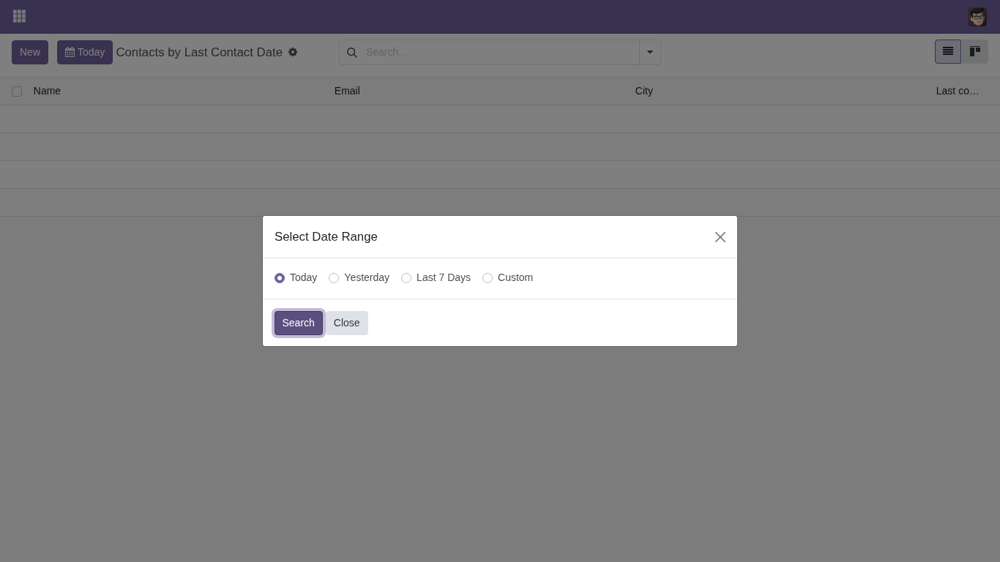
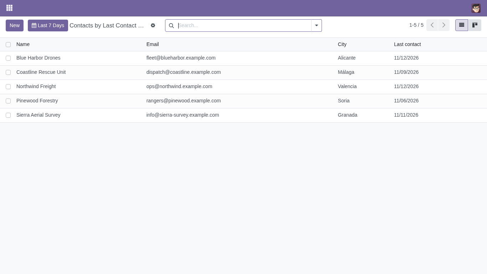
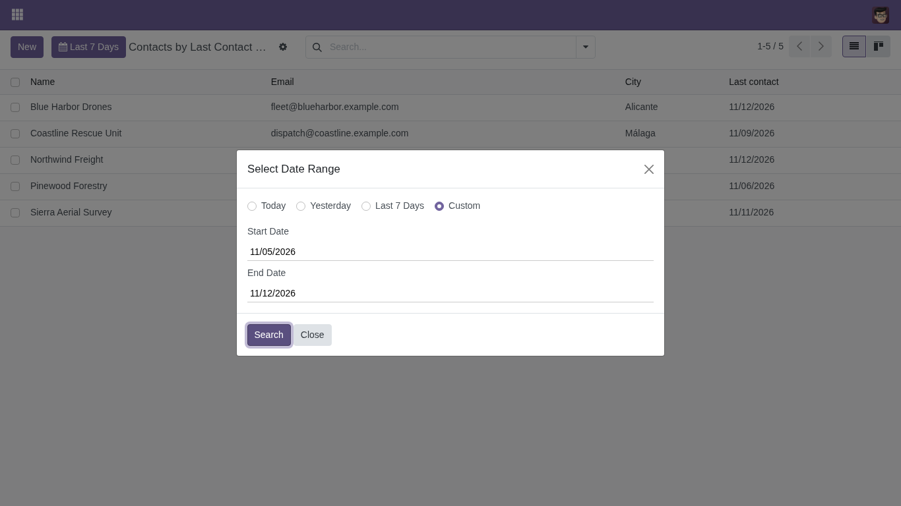

Set `js_class="date_range_list"` on a list view and mark the date or datetime
field to filter on with a `date_range` key in its `options`:

```xml
<tree js_class="date_range_list">
    <field name="name"/>
    <field name="create_date" options="{'date_range': {'max_days': 90}}"/>
</tree>
```

- `date_range`: `True`, or a dictionary with `max_days`, the longest custom
  range in days (60 by default).
- The field can be hidden with `column_invisible="True"` if it should not be a
  column.

When the list opens, a dialog asks for the range and no record is loaded until
the user confirms it:



The list then shows only the records in that range. The button next to *New*
shows the current range and opens the dialog again to change it:



*Custom* lets the user pick any start and end, up to `max_days`:



With demo data, the module adds *Settings > Users & Companies > Contacts by
Last Contact Date*: a contacts list filtered by the *Date* field, with demo
contacts dated from today back to 45 days ago.
