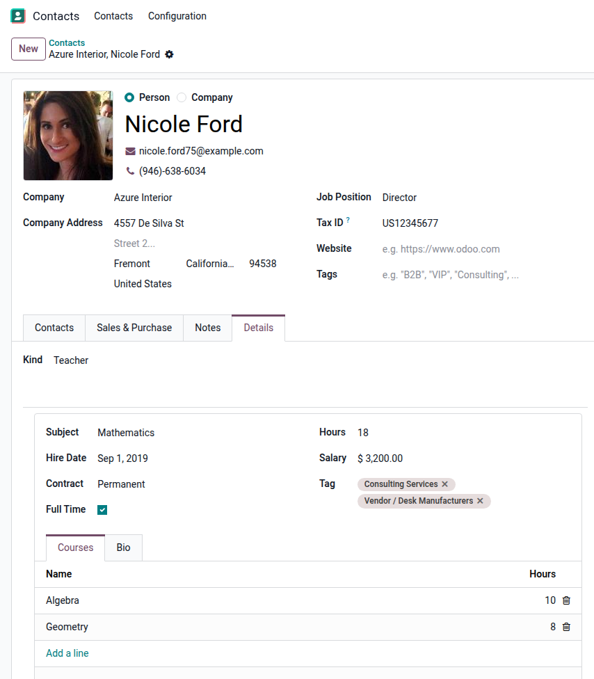
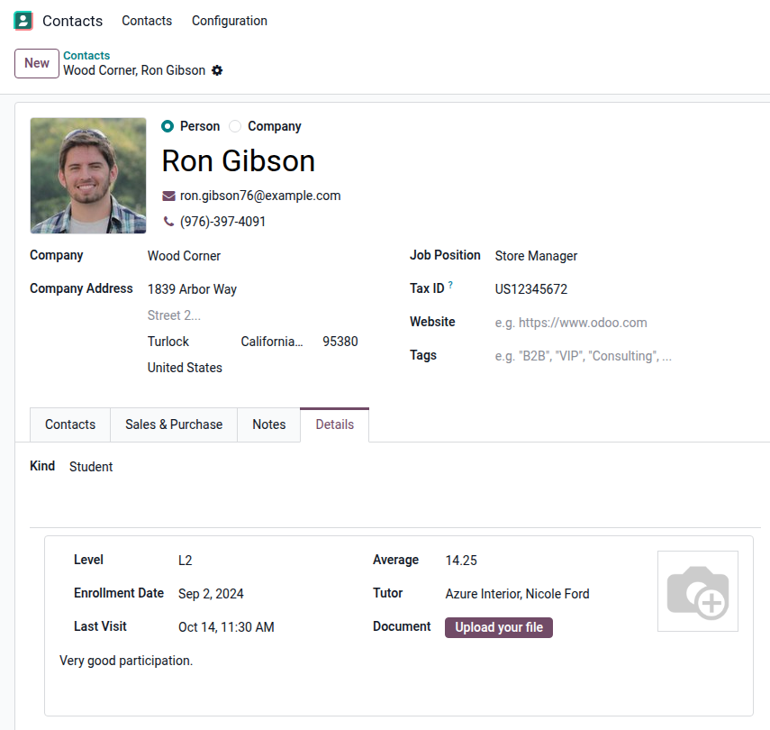

Open a partner, `Details` tab, choose a type: the matching detail is created
on save and shown below. Switching the type keeps the previous detail.

Teacher: `partner.teacher` detail, with an editable One2many and many2many tags.

Student: `partner.student` detail, with Many2one, Datetime, Image and Binary fields.

